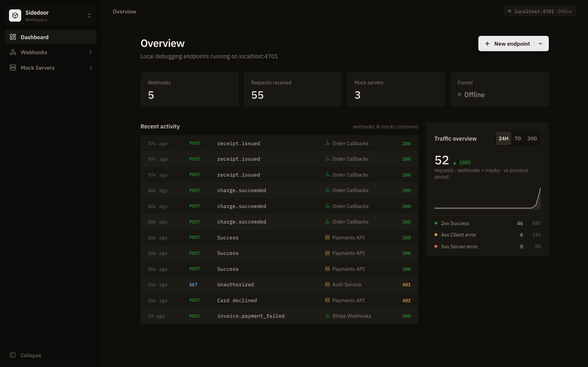
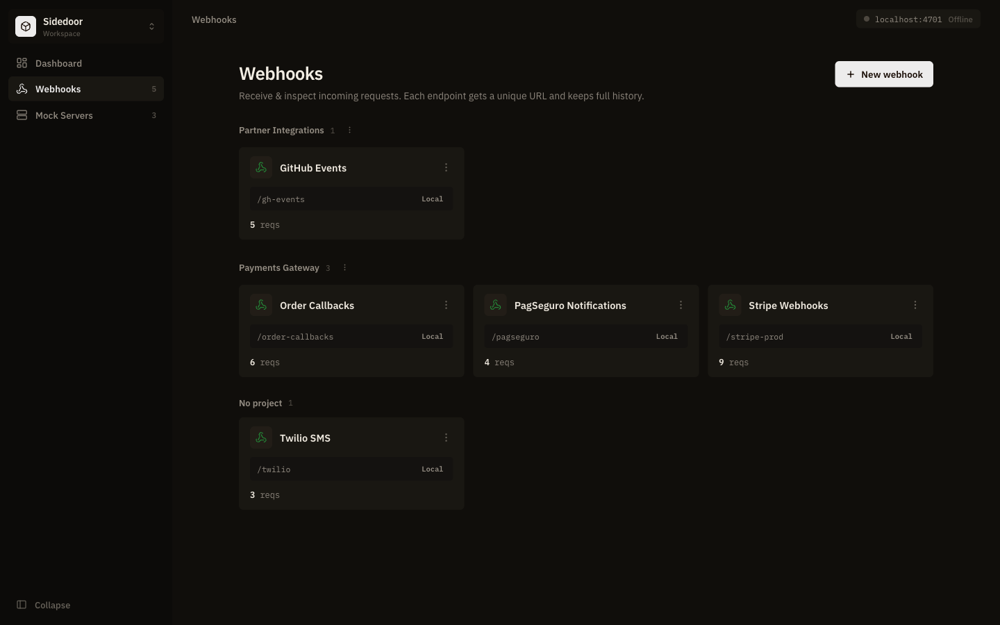
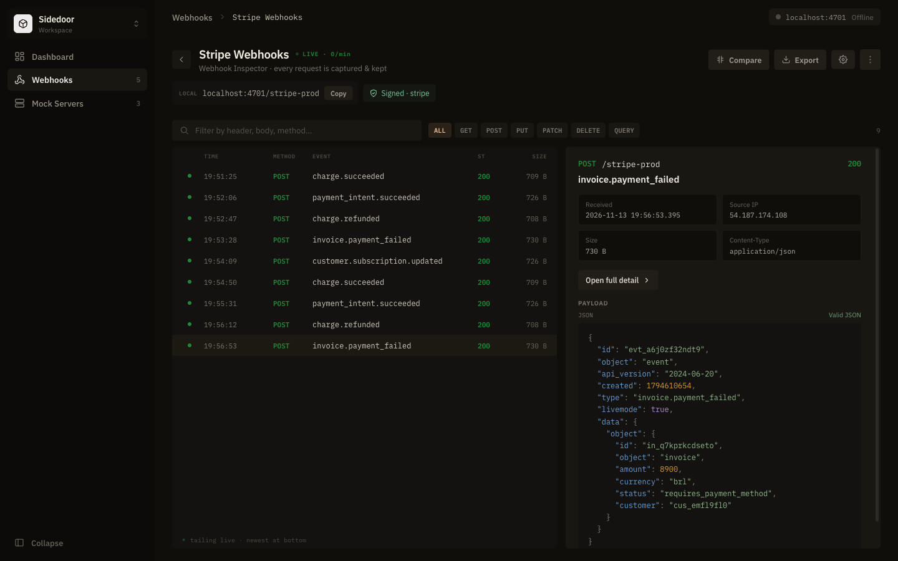
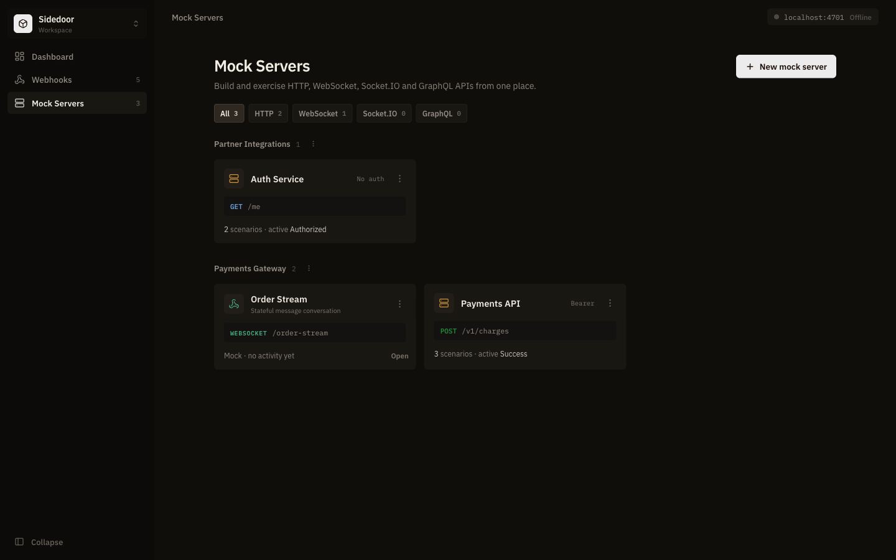
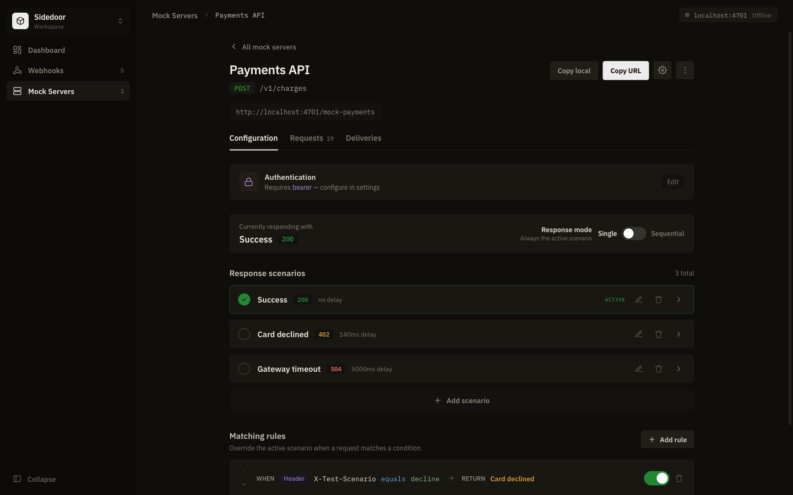
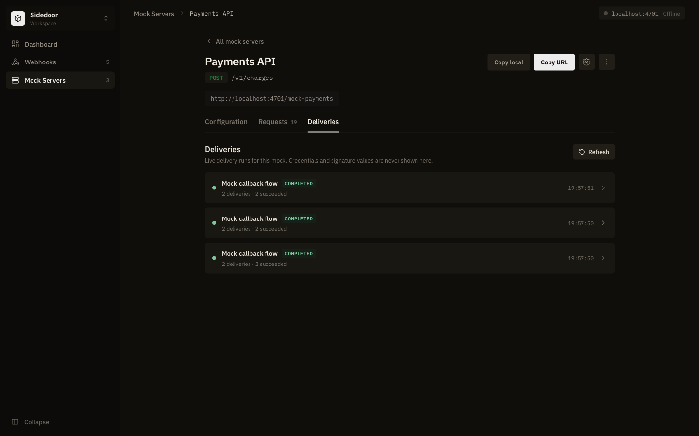
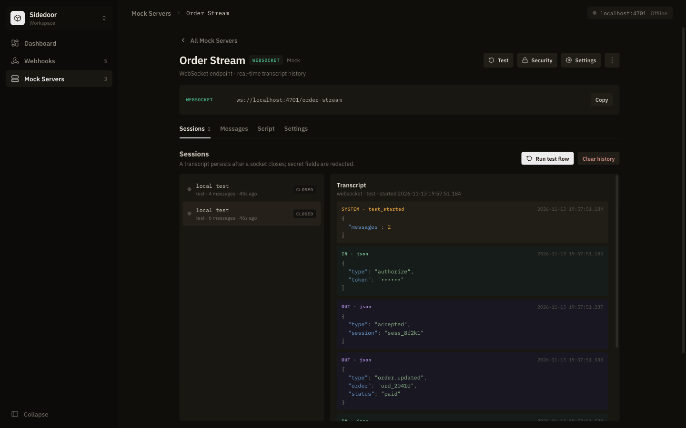
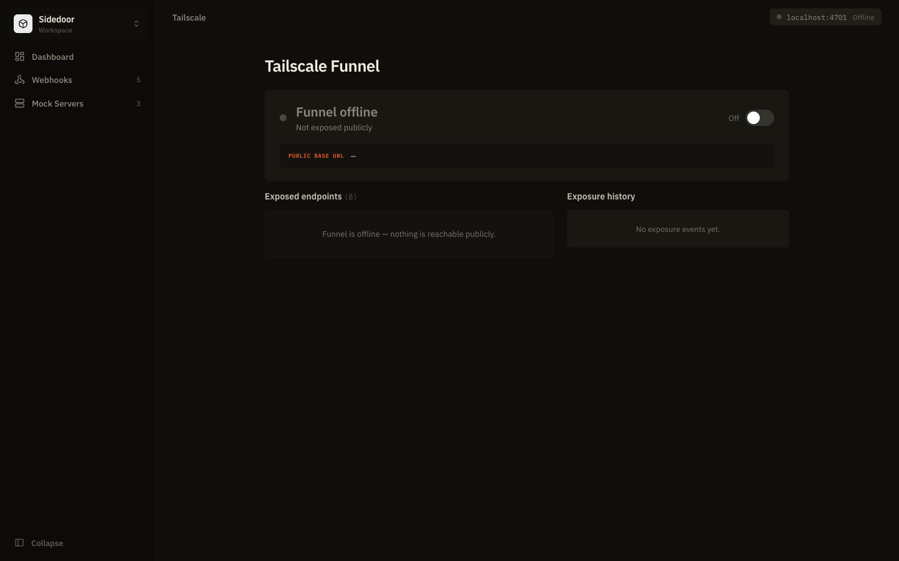

<div align="center">

# Sidedoor

**A local-first webhook inspector, API mock server, and realtime protocol test harness.**

Capture and replay webhooks, mock HTTP, WebSocket, Socket.IO, and GraphQL APIs,
send scripted callbacks, and expose a single port to the internet through
Tailscale Funnel. Everything runs on your machine and is stored in one SQLite file.


[](LICENSE)



</div>

## Contents

- [Why Sidedoor](#why-sidedoor)
- [Features](#features)
- [Screenshots](#screenshots)
- [Quick start](#quick-start)
- [Usage](#usage)
  - [Webhook inspector](#webhook-inspector)
  - [HTTP mock servers](#http-mock-servers)
  - [Async callbacks](#async-callbacks)
  - [WebSocket, Socket.IO, and GraphQL](#websocket-socketio-and-graphql)
  - [Workspaces and projects](#workspaces-and-projects)
  - [Exposing endpoints with Tailscale Funnel](#exposing-endpoints-with-tailscale-funnel)
- [Configuration](#configuration)
- [Admin API](#admin-api)
- [Architecture](#architecture)
- [Security](#security)
- [Development](#development)
- [License](#license)

## Why Sidedoor

Integrating with payment providers, SaaS webhooks, or realtime APIs usually
means waiting on a sandbox you do not control. Sidedoor gives you both sides of
the conversation locally:

- **Receive** what a provider sends, verify its signature, and inspect every
  header and byte.
- **Impersonate** a provider with deterministic responses, error scenarios,
  latency, and follow-up callbacks.
- **Expose** only the traffic port when a deployed service or a real provider
  must reach your machine.

It is a development and test tool. It is not a production webhook gateway, API
gateway, or durable replacement for a provider's delivery system.

## Features

| Area | What you get |
| --- | --- |
| **Webhook inspection** | Request capture with headers, query, and body; HMAC validation; auth; rate limits; forwarding and transform rules; replay; side-by-side diff; JSON export |
| **HTTP mocks** | Method and path matching, named response scenarios, single or sequential mode, conditional matching rules, artificial delay, and a record of every response sent |
| **Async callbacks** | Ordered, templated callbacks after a mock response, with durable delivery state, retries, cancellation, and redacted history |
| **Realtime mocks** | WebSocket, Socket.IO v4, and GraphQL (HTTP and `graphql-transport-ws`) with ordered scripts, fixtures, and persisted transcripts |
| **Organization** | Workspaces that isolate data, and projects that group endpoints inside a workspace |
| **Public exposure** | Tailscale Funnel integration that exposes the ingest listener only |
| **Live dashboard** | Endpoint counts, traffic overview, recent activity, and live updates over Server-Sent Events |

Signature presets cover **Stripe**, **GitHub**, **Shopify**, **Twilio**,
**Slack**, and custom HMAC algorithms. Auth supports Bearer tokens, API keys (in a
header or the query string), and Basic credentials.

## Screenshots

<table>
  <tr>
    <td width="50%"><br><sub><b>Webhooks</b> — endpoints grouped by project, each with its own URL.</sub></td>
    <td width="50%"><br><sub><b>Inspector</b> — live request feed, signature status, and payload preview.</sub></td>
  </tr>
  <tr>
    <td width="50%"><br><sub><b>Mock servers</b> — HTTP, WebSocket, Socket.IO, and GraphQL in one place.</sub></td>
    <td width="50%"><br><sub><b>HTTP mock</b> — response scenarios, delays, and matching rules.</sub></td>
  </tr>
  <tr>
    <td width="50%"><br><sub><b>Deliveries</b> — every callback run with its outcome.</sub></td>
    <td width="50%"><br><sub><b>Realtime</b> — scripted WebSocket conversation with a redacted transcript.</sub></td>
  </tr>
  <tr>
    <td width="50%"><br><sub><b>Tailscale Funnel</b> — public exposure state and history.</sub></td>
    <td width="50%"><br><sub><b>Dashboard</b> — counts, recent activity, and traffic by status class.</sub></td>
  </tr>
</table>

The screenshots use the demo data from `npm run seed`.

## Quick start

**Requirements:** Node.js **24 or newer** (Sidedoor uses the built-in
`node:sqlite`) and npm. Tailscale is optional and is needed only for public
exposure.

```bash
git clone https://github.com/ryan-mf-eloy/sidedoor.git
cd sidedoor
npm ci
npm start
```

Open <http://127.0.0.1:4600>. The database starts empty; run `npm run seed`
first if you want demo workspaces, endpoints, and traffic to explore.

Sidedoor starts two listeners:

| Listener | Default bind | Responsibility |
| --- | --- | --- |
| Admin (`4600`) | `127.0.0.1` | UI, REST API, SSE, and configuration |
| Ingest (`4601`) | `0.0.0.0` | Webhook and mock traffic, realtime upgrades |

Every endpoint is reached by its unique slug on the ingest listener:

```text
http://localhost:4601/<slug>
https://<machine>.<tailnet>.ts.net/<slug>   # when Funnel is enabled
```

### Scripts

| Command | Purpose |
| --- | --- |
| `npm start` | Start the admin and ingest listeners |
| `npm run dev` | Start and restart on source changes |
| `npm run seed` | Load demo workspaces, endpoints, and captured traffic into an empty database |
| `npm run reset` | Clear the database and load the demo data again |
| `npm test` | Run the complete `node:test` suite |

## Usage

### Webhook inspector

1. Open **Webhooks → New webhook**.
2. Choose a name and slug. Optionally set a project, auth, an HMAC provider, a
   rate limit, or forwarding rules.
3. Point the provider at `http://localhost:4601/<slug>`.
4. Inspect each request in the endpoint's live feed.

```bash
curl -i -X POST http://localhost:4601/example-webhook \
  -H 'content-type: application/json' \
  -d '{"event":"checkout.completed","id":"evt_123"}'
```

Forwarding rules can **forward**, **drop**, **respond**, **tag**, or **transform**
a request. Invalid credentials and signatures fail closed: an empty value never
matches. From the inspector you can replay a request, compare two requests side
by side, or export the history as JSON.

### HTTP mock servers

Create one from **Mock Servers → New mock server → HTTP API** and set the method,
path, default response, and optional auth. A mock answers only its configured
method and path (or path prefix): other methods return `405` and other paths
return `404`.

Each mock holds named **response scenarios**:

- **Single** mode always returns the active scenario.
- **Sequential** mode rotates through scenarios in order.
- **Matching rules** pick a scenario by header, body field, query parameter,
  method, or path, using `equals`, `contains`, `regex`, `exists`, `>`, `<`, or `≠`.

```bash
curl -i -X POST http://localhost:4601/mock-payments/v1/charges \
  -H 'authorization: Bearer <token>' \
  -H 'x-test-scenario: decline' \
  -H 'content-type: application/json' \
  -d '{"amount":4990,"currency":"brl"}'
```

The **Requests** tab records each request together with the response that was
returned.

### Async callbacks

Attach events to a scenario to have Sidedoor call another service after the mock
responds, as a provider would. The client response is never held open while
callbacks run.

- Events run in order, with a delay, optional repeats, and retries.
- Delivery is at-least-once. Only network errors, timeouts, `408`, `425`, `429`,
  and `5xx` responses are retried.
- Each run keeps an immutable snapshot of its configuration, so editing an event
  never redirects a delivery that is already scheduled.
- Credentials and secret-looking fields are redacted in delivery history.

URLs, headers, and bodies accept templates such as `{{request.method}}`,
`{{request.path}}`, `{{request.headers.<name>}}`, `{{request.body.<field>}}`,
`{{response.status}}`, `{{response.body.<field>}}`, and `{{randomUuid}}`.
Callback origins are fixed, redirects are refused, and timeouts are bounded.

### WebSocket, Socket.IO, and GraphQL

Choose a realtime protocol under **Mock Servers → New mock server**.

- **WebSocket** listens on `ws://localhost:4601/<slug>` and follows an ordered
  script of expected messages and actions.
- **Socket.IO v4** uses the slug as a namespace and the fixed Engine.IO path
  `/_sidedoor/socket.io/`:

  ```js
  import { io } from 'socket.io-client';

  const socket = io('http://localhost:4601/orders', {
    path: '/_sidedoor/socket.io/',
    transports: ['websocket', 'polling'],
  });
  ```

- **GraphQL** accepts HTTP operations at the slug and subscriptions over
  `graphql-transport-ws`. Define an SDL schema and deterministic fixtures in the
  endpoint configuration.

Sessions and messages are persisted with redacted payload previews. **Run test
flow** plays a scripted conversation without an external client. Live sockets
are closed, not resumed, when the process restarts.

### Workspaces and projects

Workspaces keep clients, environments, or integrations fully apart: endpoints,
requests, and settings are never shared between workspaces. Inside a workspace,
projects group related endpoints. Switch workspaces from the menu at the top of
the sidebar.

### Exposing endpoints with Tailscale Funnel

Use Funnel when a real provider or a deployed service must reach an endpoint on
your machine. Funnel exposes **only the ingest listener** (`4601`); the admin UI
and API (`4600`) stay local.

1. [Install Tailscale](https://tailscale.com/docs/install) and run
   `tailscale up`.
2. Make sure your tailnet allows Funnel (MagicDNS, HTTPS certificates, and the
   Funnel node attribute). See the
   [Funnel guide](https://tailscale.com/kb/1223/funnel).
3. Start Sidedoor and confirm the endpoint answers locally.
4. Turn Funnel on from the **Tailscale** screen, or run:

   ```bash
   tailscale funnel --bg 4601
   tailscale funnel status
   ```

   Endpoints are then reachable at `https://<machine>.<tailnet>.ts.net/<slug>`.

5. When the test is over, turn it off:

   ```bash
   tailscale funnel 4601 off
   ```

Sidedoor runs the same commands through its admin API, polls the status, and
records the exposure history. It never runs a global `tailscale funnel reset`,
so other Funnel configurations on the machine are left alone. To keep an
endpoint reachable only inside your tailnet, use
[Tailscale Serve](https://tailscale.com/docs/features/tailscale-serve) instead.

> [!WARNING]
> Treat a Funnel URL as public. Keep the admin port private and enable endpoint
> authentication or signature validation before exposing anything.

## Configuration

Every setting is optional and read from the environment.

| Variable | Default | Purpose |
| --- | --- | --- |
| `SIDEDOOR_HOST` | `127.0.0.1` | Admin bind host |
| `SIDEDOOR_PORT` | `4600` | Admin UI and API port |
| `SIDEDOOR_INGEST_HOST` | `0.0.0.0` | Ingest bind host |
| `SIDEDOOR_INGEST_PORT` | `4601` | Ingest and Funnel port |
| `SIDEDOOR_DB` | `./sidedoor.db` | SQLite path; `:memory:` is supported |
| `SIDEDOOR_MAX_BODY` | `5242880` | Maximum captured HTTP body, in bytes |
| `SIDEDOOR_MAX_REALTIME_FRAME` | `16777216` | Process-wide realtime frame limit, in bytes |
| `SIDEDOOR_TAILSCALE_BIN` | `tailscale` | Path to the Tailscale executable |
| `SIDEDOOR_FUNNEL_POLL_MS` | `10000` | Funnel status poll interval; `0` disables polling |

```bash
SIDEDOOR_PORT=4700 SIDEDOOR_INGEST_PORT=4701 SIDEDOOR_DB=/tmp/sidedoor.db npm start
```

The database file is ignored by Git. Use `SIDEDOOR_DB=:memory:` for a throwaway
instance.

## Admin API

The UI is a client of a REST API served on the admin listener at
`http://127.0.0.1:4600/__sd/api`.

```bash
curl http://127.0.0.1:4600/__sd/api/state
curl 'http://127.0.0.1:4600/__sd/api/endpoints?protocol=http'
```

Routes for endpoints, scenarios, rules, events and delivery runs, realtime
sessions, GraphQL fixtures, requests, replay, diff, export, Funnel, and the SSE
stream are defined in [`src/api/routes.js`](src/api/routes.js).

## Architecture

```text
Browser ─────────────► Admin   :4600 ──► REST / SSE ───────► SQLite
Provider or client ──► Ingest  :4601 ──► endpoint runtime ─► SQLite
Tailscale Funnel ────► Ingest  :4601 only
```

The two listeners share one store but never each other's routes: the admin
surface configures and observes endpoints, and the ingest surface only handles
traffic.

```text
src/server.js         process entry point and listener lifecycle
src/api/              admin REST router and route handlers
src/ingest/           HTTP webhook and mock dispatch, GraphQL over HTTP
src/lib/              auth, HMAC, matching, validation, realtime, delivery helpers
src/realtime-hub.js   WebSocket, Socket.IO, and GraphQL WS coordination
src/event-dispatcher.js  durable async callback queue
src/store.js          SQLite persistence and migrations
public/               dependency-free browser UI
test/                 unit, API, transport, persistence, and UI tests
docs/adr/             architecture decision records
```

Design decisions are recorded in [`docs/adr`](docs/adr):

- [0001 — Durable scenario event queue](docs/adr/0001-durable-scenario-event-queue.md)
- [0002 — Realtime protocol multiplexer](docs/adr/0002-realtime-protocol-multiplexer.md)

## Security

- The admin API binds to localhost by default and is never exposed through Funnel.
- Auth and HMAC checks fail closed, and HMAC comparisons are timing-safe.
- Callback destinations must be absolute HTTP(S) URLs without embedded
  credentials. Redirects, hop-by-hop headers, and `Host` overrides are rejected.
- Credentials, signatures, cookies, authorization headers, and sensitive JSON
  fields are redacted before delivery and realtime history is stored.
- The SQLite file holds endpoint configuration and may hold credentials. Keep it
  local and never commit it.
- Do not run Sidedoor as an internet-facing production service without adding
  authentication, access control, backups, and a data-retention plan.

## Development

```bash
npm ci
npm test
```

The `node:test` suite covers auth and HMAC providers, rate limiting, matching and
validation, SQLite migrations and cascades, the REST API, HTTP ingest, async
delivery ordering, retries, redaction, and recovery, WebSocket and Socket.IO
transports, GraphQL over HTTP and WS, and the browser UI helpers. Tests use
ephemeral ports and temporary databases and need neither Tailscale nor provider
credentials.

When you change runtime behavior, update the closest test and keep the boundary
between the admin and ingest listeners intact. Record a short ADR in `docs/adr/`
for a new persistence model, external dependency, or module boundary.

## License

Sidedoor is released under the [MIT License](LICENSE).
